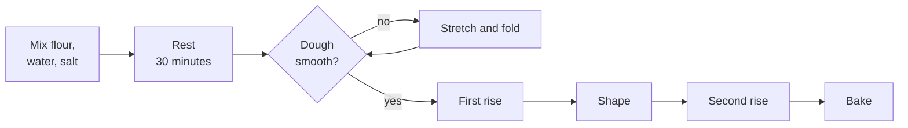
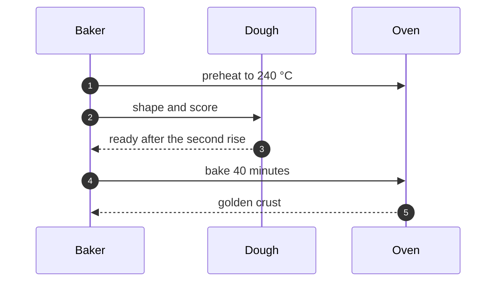
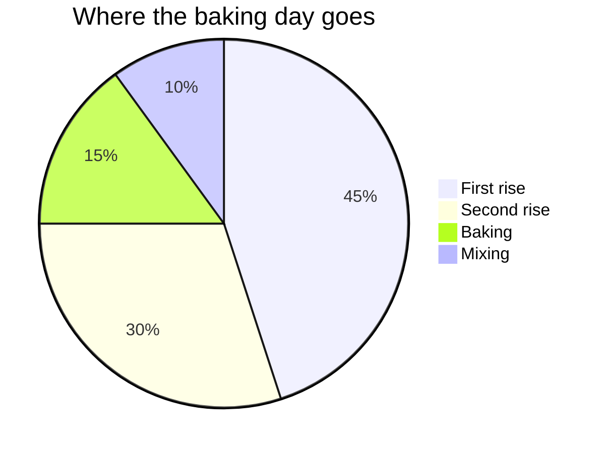

# :sparkles: Markdown Viewer demo

This is a Markdown file. With Markdown Viewer on, Safari shows it formatted, as below. Open **Contents** in the top right to jump around,
and press **⌥R** to see the raw text.

> [!TIP]
> On your Mac, Markdown files served from localhost reload by themselves when you save them, and keep your place.

## Text formatting

**Bold**, *italic*, ***both***, ~~strikethrough~~, `inline code`, and <kbd>⌘</kbd> + <kbd>S</kbd>.
Autolinks work too: https://github.com.

Unicode: naïve café, Zürich, 日本語, Ελληνικά, and emoji written directly 🚀.

## Emoji shortcodes

:rocket: :tada: :+1: :white_check_mark: :warning: :eu: :coffee: :bug: :fire: :heart:

These stay as typed: `:rocket:` in code, an unknown :not_an_emoji:, a capitalised :Rocket:,
a time of 10:30:45, and a URL with a port, http://localhost:8000/.

## GitHub alerts

> [!NOTE]
> Useful information that readers should know, even when skimming.

> [!TIP]
> Helpful advice for doing things better or more easily.

> [!IMPORTANT]
> Key information readers need to achieve their goal.

> [!WARNING]
> Urgent information that needs immediate attention to avoid problems.

> [!CAUTION]
> Advises about risks or negative outcomes of certain actions.

> A plain blockquote stays a plain blockquote.

## Footnotes

A good bread needs only four ingredients[^ingredients] and a little patience[^time].
Click a number to jump down, then the arrow to come back.

## Tables

| Bread | Flour | Rise | Oven |
|:------|:------|:----:|-----:|
| Country loaf | Wheat and rye | :white_check_mark: | 240 °C |
| Focaccia | Wheat | :white_check_mark: | 220 °C |
| Flatbread | Wheat | :x: | 250 °C |
| Banana bread | Wheat | :x: | 175 °C |

## Task list

- [x] Render Markdown
- [x] Mermaid diagrams
- [x] Contents sidebar, zoom, alerts, footnotes, copy buttons
- [x] Emoji shortcodes
- [ ] Take over the world

## Code blocks

Hover a block to see its copy button.

```bash
curl -s https://example.com/recipes.json -o recipes.json
```

```python
def hydration(water, flour):
    """Water as a share of flour, in percent."""
    return round(100 * water / flour)
```

```json
{
  "recipe": "Country loaf",
  "flour": 500,
  "water": 375,
  "hydration": 75
}
```

```
A block with no language: no highlighting, still copyable.
```

## Diagrams

Click a diagram, or the button in its corner, to open it full screen. Pinch or ⌘-scroll to zoom,
drag to move, double-click to zoom in, and press Esc to close.

### Flowchart



### Sequence



### Gantt

```mermaid
gantt
    title Baking day
    dateFormat  HH:mm
    axisFormat  %H:%M
    section Dough
    Mix and rest          :a1, 08:00, 45m
    First rise            :a2, after a1, 3h
    section Bake
    Shape and proof       :b1, after a2, 2h
    Bake                  :b2, after b1, 45m
```



### Pie



### A broken diagram

This one has a syntax error on purpose, so you see the error message and the source instead of a blank space.

```mermaid
flowchart LR
    A --> (( unclosed
```

## Images and HTML


<details>
<summary>Click to expand an HTML details block</summary>

Hidden content, with **Markdown** inside.

</details>

Safe HTML stays, scripts don't: <span title="tooltip">hover this text</span>.
<script>alert('this never runs')</script>


## Headings deep in the outline

### Third level shows in Contents

#### Fourth level does not

Heading links work: [back to the alerts](#github-alerts) or [to the diagrams](#diagrams).

---

The end :wave:

[^ingredients]: Flour, water, salt and yeast or a sourdough starter.
[^time]: A slow, cool rise gives the bread more flavour.
